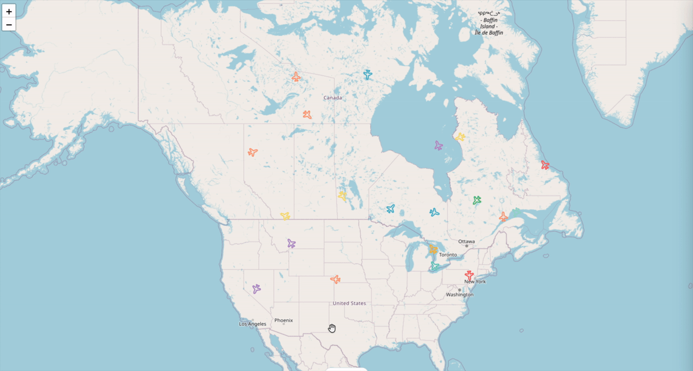
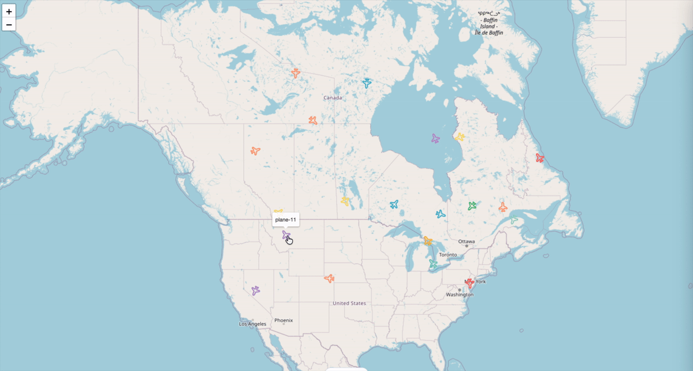

# Flight Tracker

A real-time flight tracking application built with React, TypeScript, Leaflet, and WebSockets. It displays simulated aircraft on an interactive map, with smooth live movement and detailed flight information on selection.

## Preview





## Features

- Live aircraft positions on an interactive full-screen map
- Smooth marker movement, heading, and zoom-aware sizing
- Hover, keyboard-focus, and selected marker highlight
- Live details panel for the selected flight
- Independent map and selected-flight WebSocket streams
- Connection recovery and stale-feed handling
- Keyboard-accessible marker interaction

## Tech stack

**Frontend:** React, TypeScript, Vite, Tailwind CSS, React Leaflet, Leaflet, Zod, Vitest, and React Testing Library.

**Backend:** Node.js, TypeScript, `ws`, and `dotenv`.

**Tooling:** ESLint, Prettier, Husky, and GitHub Actions.

## Architecture

```text
WebSocket messages
        ↓
Zod validation
        ↓
data hooks and reconciliation
        ↓
feature components
        ↓
Leaflet markers and details UI
```

The frontend keeps transport and validation concerns in `src/data/planes`, feature presentation in `src/features/planes`, and reusable UI/map primitives in `src/ui`.

The basic planes stream owns map positions. A separate details stream is opened only for the selected aircraft, keeping position updates and details updates isolated at their relevant render boundaries.

## Realtime and WebSocket resilience

The application uses native browser WebSockets and validates external messages with Zod before they reach the UI.

Validated application data is used as the liveness signal. Both streams include stale-feed detection, reconnect recovery, and browser offline/online handling. The details connection follows the current selection, while terminal unavailable-aircraft responses stop unnecessary retries.

## Marker interpolation

Discrete position snapshots are interpolated client-side with `requestAnimationFrame`. Each new animation starts from the marker’s currently rendered position.

After a long update gap, the marker snaps to the latest snapshot instead of performing a misleading catch-up animation. While the page is hidden, incoming snapshots are applied directly instead of starting animations, preventing catch-up movement when the tab becomes visible again.

## Accessibility

- Markers are keyboard focusable and expose accessible flight labels.
- Enter and Space select a focused marker.
- Pointer selection focuses the details panel; keyboard selection focuses its Close control.
- Escape and the Close button dismiss the panel.
- Hover, focus, and selection use the same visual marker state.

## Getting started

Use Node.js 22 to match the CI environment.

Clone the repository, then install the root package to enable the pre-push hook:

```bash
git clone https://github.com/RiccardoFerranti/flight-tracker.git
cd flight-tracker
npm ci
```

### Backend

```bash
cd be
npm ci
cp .env.example .env
npm run dev
```

The local simulator listens on `127.0.0.1:4000`.

| Variable                      | Default |
| ----------------------------- | ------- |
| `PORT`                        | `4000`  |
| `PLANES_COUNT`                | `20`    |
| `BASIC_UPDATE_INTERVAL_MS`    | `1000`  |
| `DETAILED_UPDATE_INTERVAL_MS` | `1000`  |

### Frontend

Open a second terminal:

```bash
cd fe
npm ci
cp .env.example .env
npm run dev
```

The backend must be running before the frontend can receive live data.

| Variable                    | Local value                             |
| --------------------------- | --------------------------------------- |
| `VITE_PLANES_BASIC_WS_URL`  | `ws://localhost:4000/ws/planes/basic`   |
| `VITE_PLANE_DETAILS_WS_URL` | `ws://localhost:4000/ws/planes/details` |

## Useful scripts

From `fe/`:

- `npm run dev` — start the development server
- `npm run check` — run linting, type checking, and tests
- `npm run test:watch` — run tests in watch mode
- `npm run build` — create a production build
- `npm run preview` — preview the production build

From `be/`:

- `npm run dev` — start the simulator in development
- `npm run build` — compile the backend
- `npm run start` — run the compiled backend

Run `npm run build` before `npm run start` in `be/`.

## Testing and quality

The frontend uses Vitest and React Testing Library for schemas, WebSocket lifecycle and recovery, marker behavior, map interaction, and details-panel states.

`npm run check` runs linting, type checking, and tests. Husky runs this check before push, and GitHub Actions runs it on pushes and pull requests.

## Technical decisions

- **Leaflet and React Leaflet** provide map rendering while preserving direct Leaflet marker control for realtime updates.
- **Native WebSockets** keep transport behavior explicit and lightweight.
- **Zod at the data boundary** prevents malformed messages from reaching presentation components.
- **Stable `DivIcon` DOM** preserves marker interaction and visual state during realtime updates.
- **Interpolation without prediction** keeps movement smooth without presenting inferred paths as live data.

## Known limitations

- The simulator is intended for local use and binds to the loopback interface.
- The map uses OpenStreetMap public tiles; usage should follow its tile policy.
- The application shows current movement only and does not store historical tracks or predict future trajectories.
